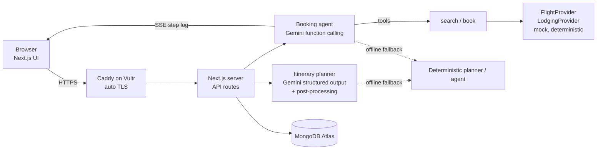

# Tripaholic

**Plan the whole trip in one place.** A booking agent searches, compares, explains, and books your flights and stay. Gemini plans your days on a calendar you can drag, edit, and regenerate. You never leave the site.

Live: `https://<your-domain>` (GoDaddy Registry domain → Vultr; see [Deploy](#deploy))

## What it does

| Page | What you can do |
|---|---|
| **Trips** (home) | See trips grouped as Planned, In progress, and Archived (status is derived from the dates in the destination's time zone, or set manually by archiving). **New Trip** is a required 3-step flow: location (with autocomplete), then whether you're traveling the **city**, **state**, or **country**, then title and dates. |
| **Flights** | Tell the agent what matters ("cheapest direct flight from JFK, arriving before noon"). Watch its live log: it searches, filters, compares, explains its pick with numbers, and books. Turn off auto-book to get a **Confirm booking** card instead, or ask for **another option** and the agent proposes the next best. |
| **Lodging** | Same agent for hotels and Airbnb-style homes ("best rated hotel near the center with breakfast"). |
| **Itinerary** | Google Calendar-style view limited to the trip dates. **Generate with AI** fills it with events planned around your flights, hotel, and your own plans, with a "Why this plan" summary and a reason on every event. Drag, resize, delete, add your own, and **Regenerate**: your events, bookings, and any AI event you moved stay put. **Export .ics** adds it to Google, Apple, or Outlook Calendar. |

## Demo script (under 3 minutes)

1. Home shows planned, in-progress, and archived trips (seeded).
2. **New Trip**: type "Tokyo", pick it, choose **City**, set dates a few weeks out, **Create trip**.
3. **Flights**: "cheapest direct flight from JFK arriving before noon" → **Search with AI**. Point out the log: tool calls with arguments, the second search a day earlier (long-haul), the comparison, the rationale, the confirmation code.
4. **Lodging**: "best rated hotel near the center with breakfast". Booked, with check-in/out on the calendar.
5. **Itinerary** → **Generate with AI**. Events start after landing + transfer and end before the airport run. Open **Why this plan**; click an event for its reason.
6. Drag an event (📌 pinned), delete one, click an empty slot to add your own, then **Regenerate**: yours and the pinned one survive.
7. Back to **Trips**: Tokyo is under Planned.

`npm run demo:check -- https://<your-domain> --runs 3` runs this exact flow over HTTP and checks every step.

## How each sponsor technology is used

**Google Gemini** (`@google/genai`, model from `GEMINI_MODEL`), used in four distinct ways:
1. **Structured-output itinerary planner** (`lib/ai/planner.ts`): a JSON schema plus zod validation, with one corrective retry. The prompt carries the scope rules (one city, or a multi-city route with travel blocks), booking constraints, and fixed events. Deterministic post-processing (`lib/ai/postprocess.ts`) then enforces trip range, flight windows, daily hours, no overlaps, and pacing.
2. **Function-calling booking agent** (`lib/ai/agent.ts`): a tool loop (`search_flights` / `book_flight`, or `search_lodging` / `book_lodging`) of up to 8 steps, with thought signatures preserved. Every thought, call, and result is streamed to the UI over SSE and saved to `agentRuns`.
3. **Reasoned explanations**: a "why I picked this" on every event, the plan summary and themes, and a booking rationale that cites prices, times, and the runner-up.
4. **Search grounding** (optional, `GEMINI_GROUNDING=true`) so planner suggestions reflect real places. It falls back cleanly when a model can't combine it with structured output.

Failures are typed (`auth`, `rate_limit`, `timeout`, …). 429/5xx get bounded retries. When Gemini is unavailable, a deterministic offline planner and agent take over, and the UI says so, so the demo never dead-ends.

**MongoDB Atlas**: all app data lives in Atlas through the official driver (`lib/db.ts`, `lib/store/`). Collections are `trips`, `events`, `itinerarySummaries`, `bookings`, and `agentRuns` (the agent's step log). Indexes are created on connect: `trips(userId,startDate)`, `events(tripId,start)`, `bookings(tripId)`, `agentRuns(tripId)`, and a unique `itinerarySummaries(tripId)`. Without `MONGODB_URI`, local development uses a JSON file with the same repository API.

**Vultr**: production runs on a Vultr Cloud Compute VM (Ubuntu 24.04). It's a Next.js standalone server under systemd, behind Caddy (automatic HTTPS, SSE-friendly proxying). One script sets it all up: `deploy/setup.sh`.

**GoDaddy Registry domain**: a travel-themed domain whose A records point at the Vultr VM. Caddy obtains and renews its certificate.

## Architecture



```
app/                     pages and API routes (App Router)
  api/trips/...          trips, events, itinerary generate/summary, agent (SSE), bookings, confirm
components/              trips home, itinerary (FullCalendar), agent panel, shell
lib/ai/                  gemini client, planner, post-processing, agent, tools, offline fallbacks
lib/providers/           provider interfaces + mock flight/lodging providers
lib/store/               repository over MongoDB (or the local file store)
lib/bookings.ts          booking → bookings record + itinerary blocks
scripts/                 seed, smoke tests, demo-flow check
deploy/                  Vultr setup/deploy scripts, systemd unit, Caddyfile
```

## Run locally

```bash
npm install
cp .env.example .env.local     # MONGODB_URI, GEMINI_API_KEY, GEMINI_MODEL (both optional locally)
npm run smoke:mongo            # Atlas: ping + write/read/delete
npm run smoke:gemini           # Gemini: text + structured output
npm run seed                   # demo trips: planned, in progress, archived (with itineraries)
npm run dev                    # http://localhost:3000
```

| Script | |
|---|---|
| `npm run dev` / `npm run build` / `npm start` | Next.js dev / production build / server |
| `npm test` | 73 unit tests (status rules, validation, post-processing, regenerate preservation, providers, agent end to end, Gemini error handling, routes, .ics export) |
| `npm run typecheck` | `tsc --noEmit` (strict) |
| `npm run seed` | Re-creates only the seeded demo trips |
| `npm run smoke:mongo` / `smoke:gemini` | Connectivity checks (exit 1 if not configured) |
| `npm run demo:check -- <url> [--runs 3] [--keep]` | The demo flow above, over HTTP |

`GET /api/health` reports the active store, database reachability, and whether Gemini is configured. It never includes secrets.

## Deploy

On a fresh Vultr **Cloud Compute** VM (Ubuntu 24.04; 2 GB RAM recommended, smaller plans get swap automatically):

1. **Atlas**: create a database user and, under *Network Access*, allow the VM's public IP.
2. **Domain** (GoDaddy Registry): add an `A` record for `@` and `www` pointing to the VM's IP.
3. **Server**:
   ```bash
   curl -fsSL https://raw.githubusercontent.com/lavanpkumar/tripaholic/main/deploy/setup.sh -o setup.sh
   sudo bash setup.sh your-domain.example        # installs Node 22 + Caddy, clones, writes /opt/tripaholic/.env
   sudo nano /opt/tripaholic/.env                # fill in what you have: MONGODB_URI, GEMINI_API_KEY, GEMINI_MODEL, NEXT_PUBLIC_APP_URL
   sudo bash setup.sh your-domain.example        # checks, build, systemd service, firewall, HTTPS
   cd /opt/tripaholic/app && sudo -u tripaholic npm run seed
   ```
   Missing keys don't block a deploy. Without `GEMINI_API_KEY` (or if its check fails) the app runs the offline planner and agent. Without `MONGODB_URI` it uses a local file store in `/opt/tripaholic/data`, which is kept across deploys. The script ends by saying which mode each one is in. A `MONGODB_URI` that is set but fails its check always stops the script. Once both keys are in, rerun with `--strict` (`sudo bash setup.sh your-domain.example --strict`): it fails unless Atlas and Gemini both check out. Use that for the final pre-submission deploy.
4. Check it: `curl https://your-domain.example/api/health`, then `npm run demo:check -- https://your-domain.example --runs 3` from your laptop.

Updates: `sudo /opt/tripaholic/app/deploy/deploy.sh main` (pull, `npm ci`, build, restart, health check). Logs: `journalctl -u tripaholic -f`.

## Honest notes

- Flights and stays come from a **mock provider**: deterministic, realistic options with fictional airlines and generated properties. Bookings are real records in the database, but nothing is purchased. The UI labels this "Demo data". A real provider can be added behind `FlightProvider` / `LodgingProvider` (`PROVIDER_MODE=real` is reserved for that).
- There is one demo user and no authentication, by design for the hackathon.
- See `DECISIONS.md` for every deviation from `PLAN.md`.

## Dev workflow

Claude Code implemented each phase of `PLAN.md` on its own branch (`cc/phase-<n>-<name>`), committed, pushed, and wrote `HANDOFF.md`. Grok Bot reviewed each pull request. Claude Code answered every review with follow-up commits on the same branch and a reply on the PR, and fixes were merged forward through the stacked branches. A human merged to `main`. See `docs/SUBMISSION.md` for the submission checklist and project-description draft.
